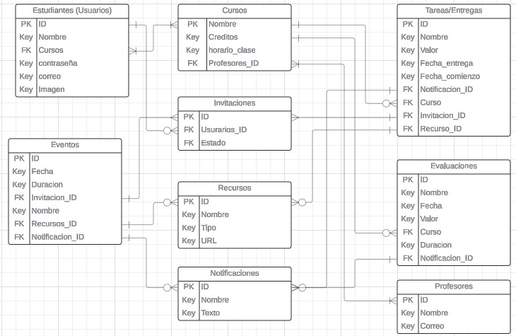

# E0 :construction:

* :pencil2: **Nombre Grupo:** Completar nombre de grupo

## Descripción general :thought_balloon:

- ¿De qué se tratará el proyecto? El proyecto se tratará de un Planner para estudiantes, el cual permita organizar el tiempo que se dedica a cada actividad del semestre.
- ¿Cuál es el fin o la utilidad del proyecto? La utilidad de esta aplicación es poder darle al usuario una herramienta para organizar su semestre y poder organizar horarios de estudio con otros usuarios.
- ¿Quiénes son los usuarios objetivo de su aplicación? Los principales usuarios son alumnos de la UC, pero puede ser usado por cualquier alumno universitario o escolar.

## Historia de Usuarios :busts_in_silhouette:

1. Como visita, quiero poder registrarme en la página, para poder iniciar sesión y guardar mi información.
2. Como visita, quiero poder ver la información de los distintos ramos, para conocer la carga que implica.
3. Como usuario, quiero poder agregar ramos a mi cuenta, para poder visualizarlos en mi página principal.
4. Como usuario, quiero poder crear eventos, como sesiones de estudio o reuniones de trabajo, para coordinar mi tiempo.
5. Como usuario, quiero poder agregar mis notas en los ramos, para poder conocer mi promedio actual.
6. Como usuario, quiero poder marcar tareas y eventos como completados, para saber que es lo que me queda por hacer.
7. Como usuario, quiero poder unirme a eventos que me inviten, para que estos se reflejen en mi calendario.
8. Como usuario, quiero recibir notificaciones de eventos y tareas por ocurrir, para recordar cuando van a ocurrir.
9. Como usuario, quiero poder cambiar los colores de mi pagina principal, para poder usarlo en modo claro o modo oscuro.
10. Como usuario, quiero poder ver mi calendario con todas las cosas que tengo agendadas, para poder organizar mis semanas y ver que tiempos tengo ocupados.
11. Como administrador, quiero agregar ramos, para poder mantener una base de datos amplia.
12. Como administrador, quiero poder modificar la información de ramos que ya existen, para poder mantenerlos actualizados según los programas.

## Diagrama Entidad-Relación :scroll:
<!-- Insertamos la imagen ER-Model.png -->

## Diseño Web :computer:

<!-- Documento de diseño web -->
### :art: Documento de diseño

<!-- Vistas principales -->
### :mag: Vistas principales

<!-- Logo -->
### :art: Logo

