# BrainBox: planner académico para estudiantes

Aplicación web para organizar el semestre: ramos, notas, tareas, eventos de estudio compartidos y calendario. Proyecto grupal del curso IIC2513 (Tecnologías y Aplicaciones Web, PUC Chile, 2024-2).

**Demo:** https://iic2513-brainbox.netlify.app

## Qué hace

- Registro e inicio de sesión (JWT) para estudiantes y administradores
- Catálogo de ramos y carga de cada uno; el usuario agrega ramos a su cuenta
- Calendario semanal y mensual con eventos y tareas; creación de sesiones de estudio y reuniones, e invitación a otros usuarios
- Notas por ramo con promedio actual; marcar tareas y eventos como completados
- Notificaciones, modo claro/oscuro
- Panel de administración para crear y editar ramos

## Stack

React 18, Vite, React Router, Axios, jwt-decode, IndexedDB (`idb`), date-fns y moment. Despliegue en Netlify con CI en GitHub Actions. El backend vive en un repositorio aparte.

## Equipo

Florencia Aqueveque ([@Flo-aq](https://github.com/Flo-aq)), [@cpschulz](https://github.com/cpschulz), [@vich1n](https://github.com/vich1n) y [@rodrigoogalde](https://github.com/rodrigoogalde). El historial conserva la autoría de cada integrante.

## Ejecutar localmente

```bash
cp .env.example .env   # definir VITE_BACKEND_URL
npm install
npm run dev
```

## Estructura

```
src/Pages/        Landing, LogIn, SignUp, Calendar, UserClasses, AdminClasses, Instructions, AboutUs
src/Components/   Calendario, formularios, popups, navbar, rutas protegidas
src/Api/          Cliente HTTP hacia el backend
src/auth/         Manejo de sesión y token
src/db/           Almacenamiento local (IndexedDB)
```

---

# Documentación de la entrega original (E0)

## Historia de Usuarios :busts_in_silhouette:

1. Como visita, quiero poder registrarme en la página, para poder iniciar sesión y guardar mi información.
2. Como visita, quiero poder ver la información de los distintos ramos, para conocer la carga que implica.
3. Como usuario, quiero poder agregar ramos a mi cuenta, para poder visualizarlos en mi página principal.
4. Como usuario, quiero poder crear eventos, como sesiones de estudio o reuniones de trabajo, para coordinar mi tiempo.
5. Como usuario, quiero poder agregar mis notas en los ramos, para poder conocer mi promedio actual.
6. Como usuario, quiero poder marcar tareas y eventos como completados, para saber que es lo que me queda por hacer.
7. Como usuario, quiero poder unirme a eventos que me inviten, para que estos se reflejen en mi calendario.
8. Como usuario, quiero recibir notificaciones de eventos y tareas por ocurrir, para recordar cuando van a ocurrir.
9. Como usuario, quiero poder cambiar los colores de mi pagina principal, para poder usarlo en modo claro o modo oscuro.
10. Como usuario, quiero poder ver mi calendario con todas las cosas que tengo agendadas, para poder organizar mis semanas y ver que tiempos tengo ocupados.
11. Como administrador, quiero agregar ramos, para poder mantener una base de datos amplia.
12. Como administrador, quiero poder modificar la información de ramos que ya existen, para poder mantenerlos actualizados según los programas.


## Diagrama Entidad-Relación :scroll:
<!-- Insertamos la imagen ER-Model.png -->
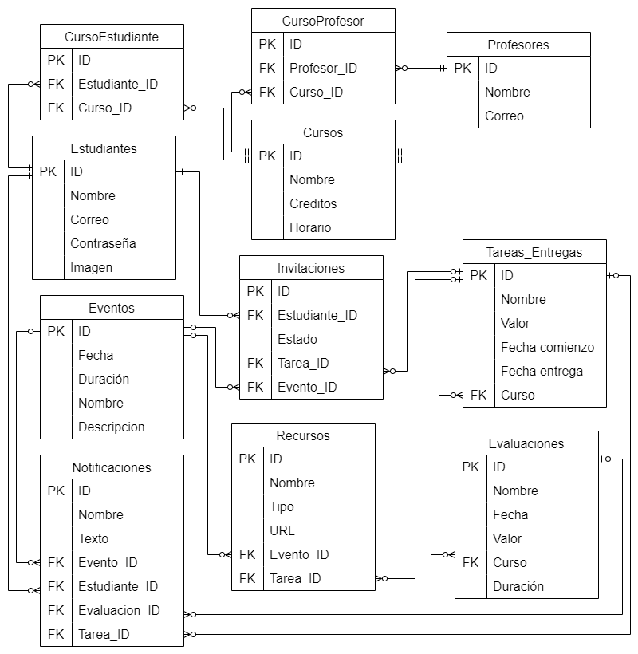

## Diseño Web :computer:

<!-- Documento de diseño web -->
### :art: Documento de diseño y :art: Logo
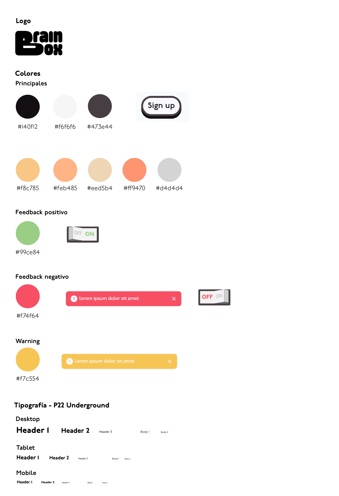


<!-- Vistas principales -->
### :mag: Vistas principales
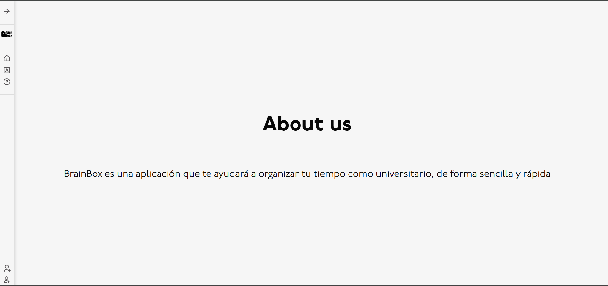
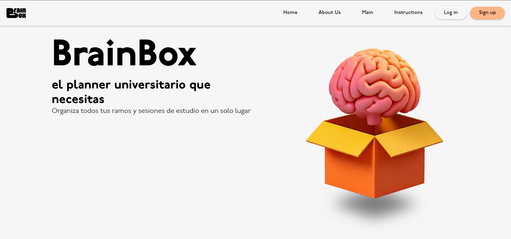
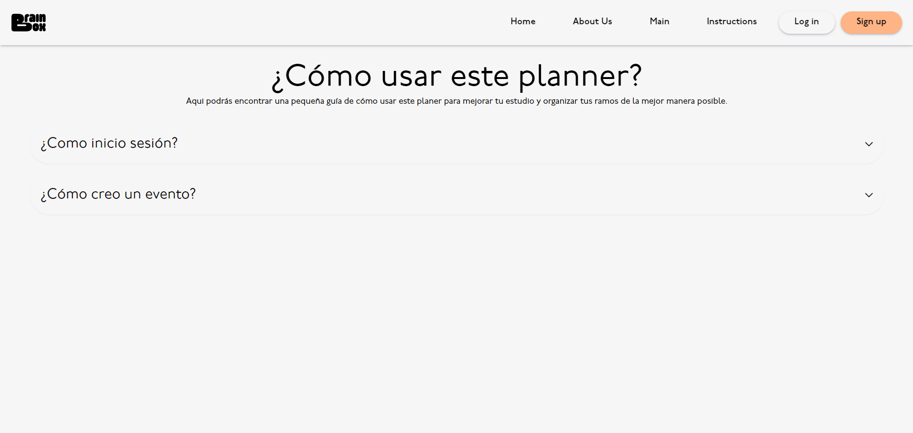
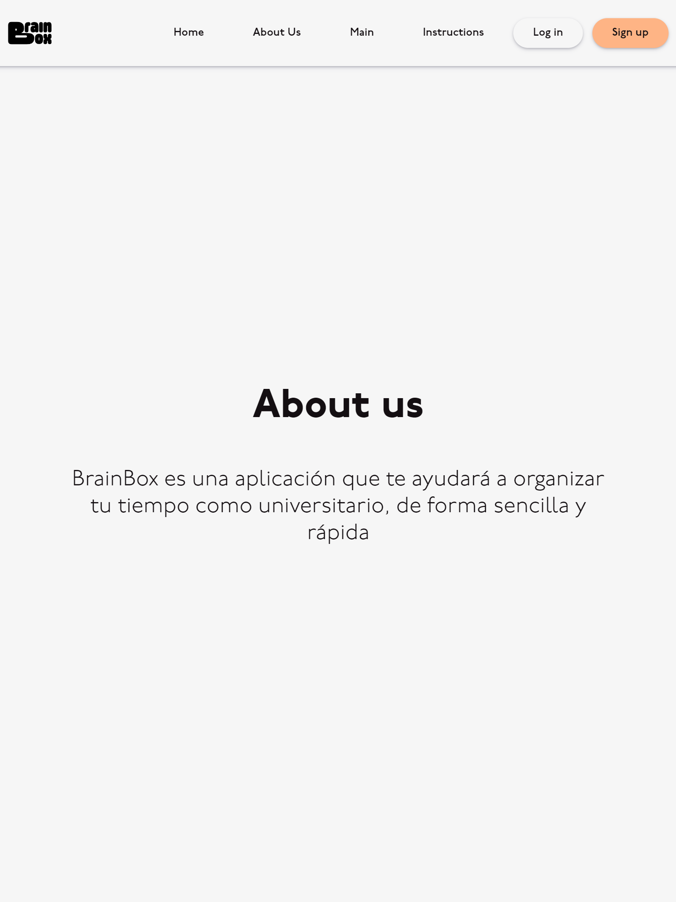
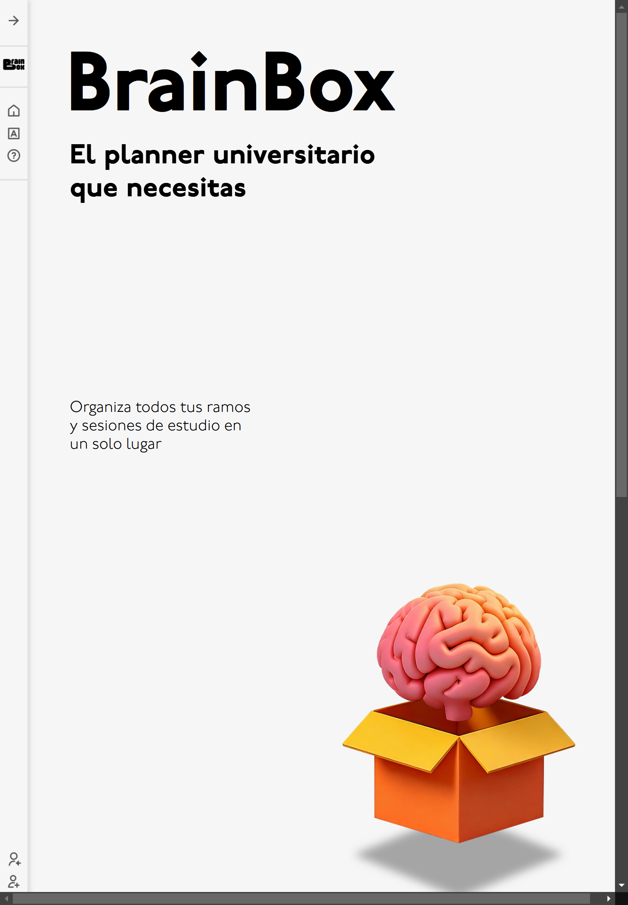
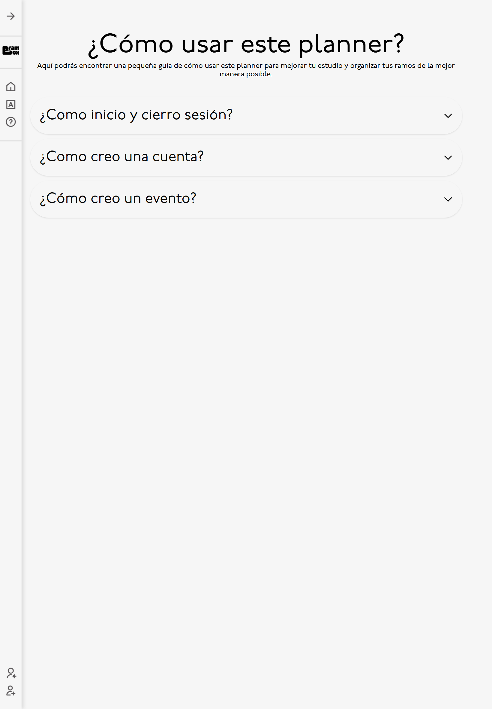
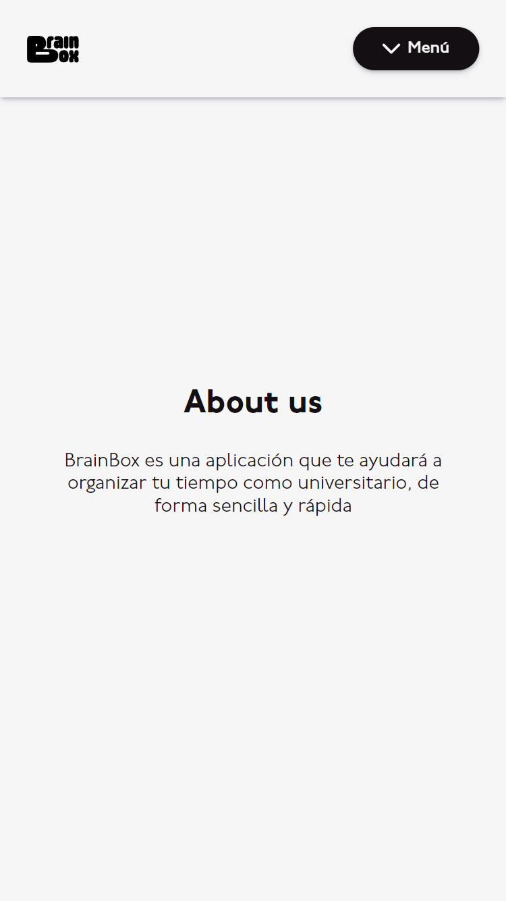
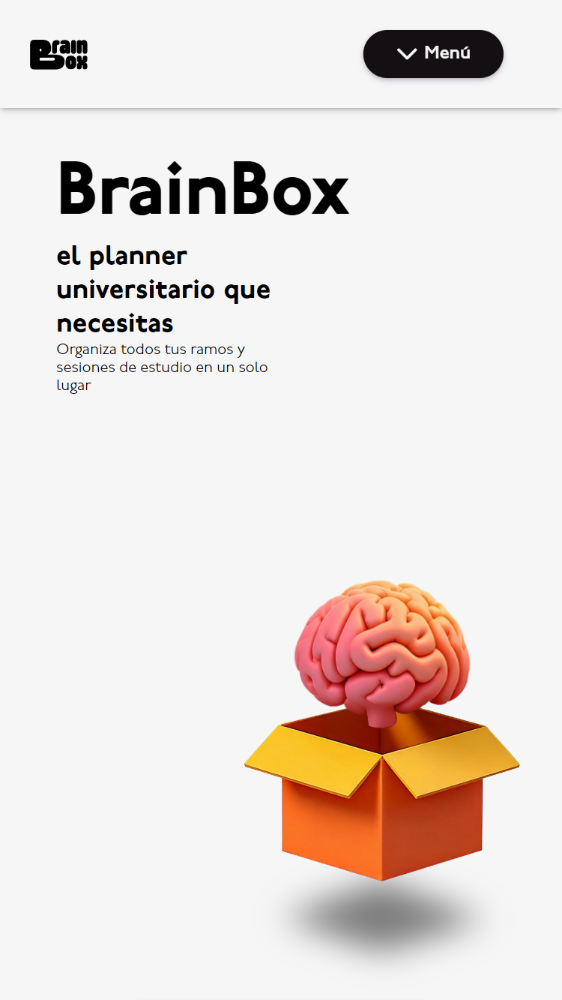
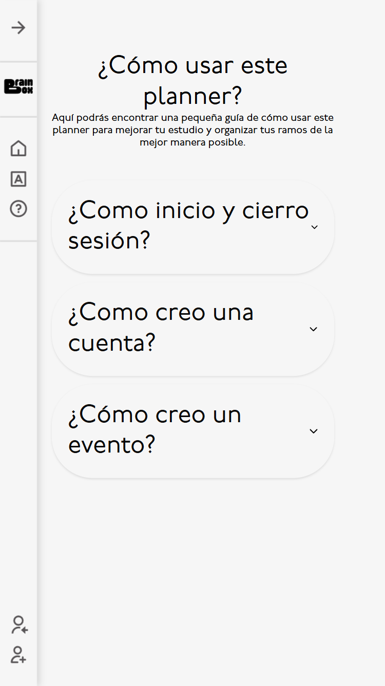

### Assets Externos y Referencias
https://uiverse.io/EmmaxPlay/itchy-bobcat-50

https://uiverse.io/Yaya12085/ugly-cat-20

https://uiverse.io/abrahamcalsin/grumpy-ape-40

https://uiverse.io/absoluteSTrange/cowardly-sloth-96

https://uiverse.io/SachinKumar666/spicy-tiger-75

https://uiverse.io/kamehame-ha/ancient-insect-32

https://www.youtube.com/watch?v=RWz23UKXdAk

https://answers.netlify.com/t/problem-when-navigating-routing/98037

https://codesandbox.io/p/sandbox/react-accordion-hbuc2?file=%2Fsrc%2FApp.js

### Otros
Se usó chatgpt para ordenar código y crear la animación del cerebro.

Se usó Adobe Firefly para crear las imágenes e iconos
